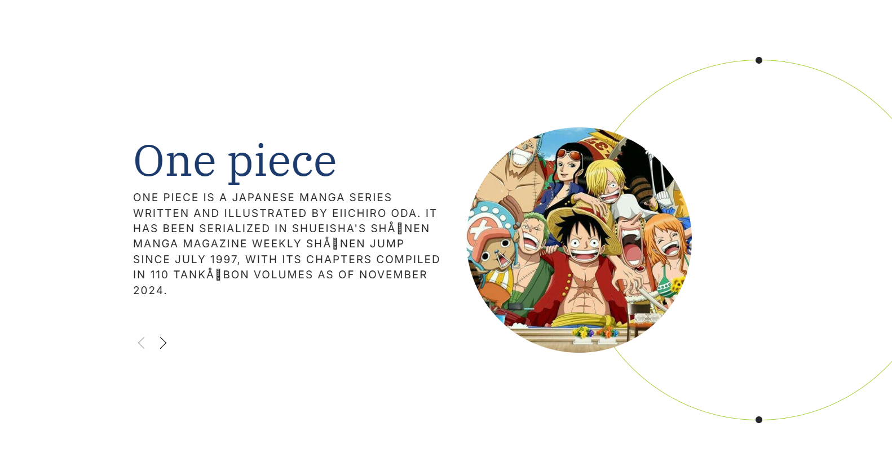
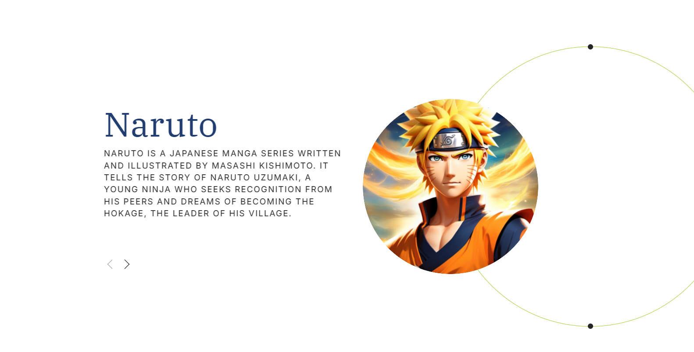
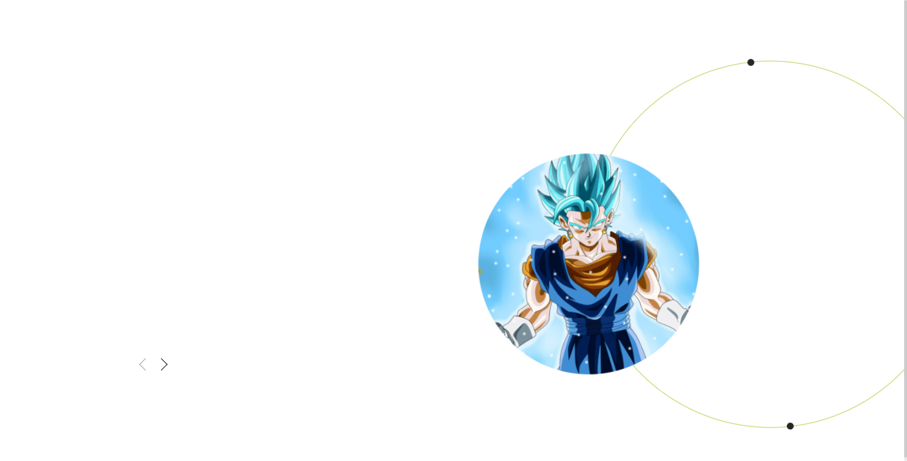

# 🎡 Anime Spinning Carousel Animation

<div align="center">

[](https://developer.mozilla.org/en-US/docs/Web/HTML)
[](https://developer.mozilla.org/en-US/docs/Web/CSS)
[](https://developer.mozilla.org/en-US/docs/Web/JavaScript)
[](LICENSE)

An interactive, circular rotating carousel featuring popular anime franchises with smooth CSS orbital transitions, synopsis cards, and autoplay.

<br/>



</div>

---

## 📸 Previews

| One Piece | Naruto |
| :---: | :---: |
|  |  |
| **Straw Hat Pirates Showcase** | **Hokage Journey & Lore** |

| Dragon Ball Z | Demon Slayer |
| :---: | :---: |
|  |  |
| **Z Warriors Adventure** | **Kimetsu no Yaiba Chronicle** |

---

## ✨ Features

- 🎡 **Circular Orbital Rotation**: Smooth mathematical rotation along a circular path.
- 📖 **Interactive Synopsis Cards**: Detailed franchise summaries that fade and slide dynamically.
- ⏱️ **Configurable Autoplay**: Automatically rotates through slides with mouse-hover pause.
- 🎛️ **Navigation Controls**: Next/previous directional buttons and interactive orbital dot indicators.
- ⚡ **Lightweight Vanilla Code**: Pure HTML, CSS animations, and vanilla JavaScript without external libraries.

---

## 🎮 Controls

| Action | Control |
| :--- | :--- |
| **Next / Previous Slide** | Click the **`<`** and **`>`** navigation arrows |
| **Direct Slide Jump** | Click any orbital dot along the perimeter ring |
| **Pause Autoplay** | Hover mouse cursor over the carousel area |

---

## 🚀 How to Run

1. **Option A (Instant)**: Double-click `index.html` in your file browser.
2. **Option B (Local Server)**:
   ```bash
   python -m http.server 8000
   ```
   Then open [`http://localhost:8000`](http://localhost:8000).

---

## 📄 License

MIT License © 2026 [Sooraj Studio](https://github.com/soorajstudio)
